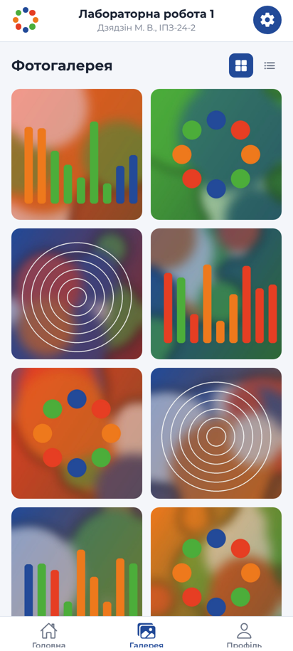
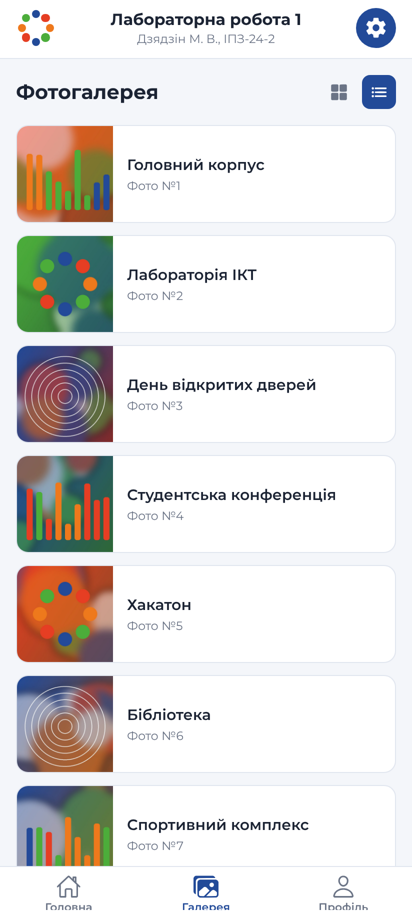
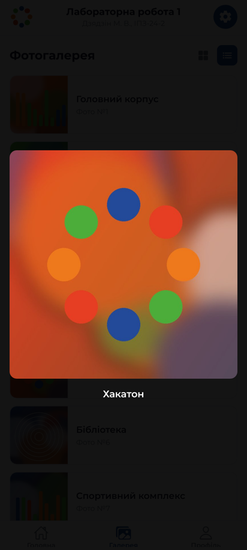
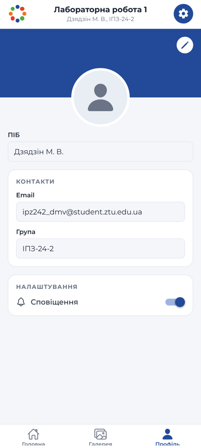
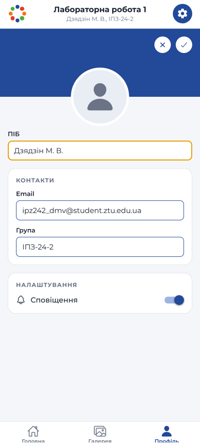
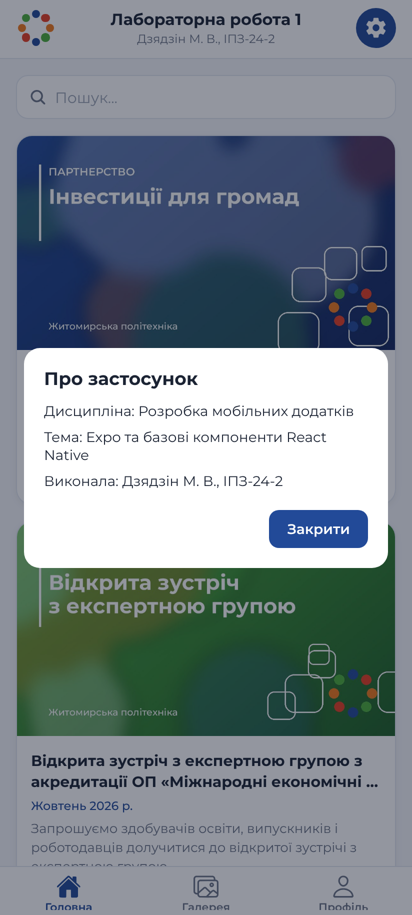

# Лабораторна робота №1

**Тема:** Використання Expo для створення найпростішого додатку React Native. Знайомство з основними компонентами.

**Мета:** навчитися створювати та налаштовувати проєкт у середовищі Expo, ознайомитися зі структурою React Native застосунку та опанувати навички роботи з базовими компонентами.

**Виконала:** Дзядзін М. В., група ІПЗ-24-2
**Викладач:** Нерода С. І.

---

## Опис проєкту

Мобільний застосунок з трьома вкладками в бренд-стилі Державного університету «Житомирська політехніка» ([media.ztu.edu.ua](https://media.ztu.edu.ua/)): фірмові кольори `#224A98`, `#4CAD3B`, `#E53E23`, `#EE781C` і шрифт Montserrat.

| Екран | Що реалізовано |
|---|---|
| **Головна** | Стрічка новин університету (`FlatList`), картка з обкладинкою, заголовком, датою та анотацією; пошук через `TextInput`; натискання відкриває новину у вбудованому браузері (`expo-web-browser`) |
| **Галерея** | Перемикання сітки (2 колонки) і списку (`numColumns`), повноекранний перегляд фото у `Modal` |
| **Профіль** | Банер, аватар, поля ПІБ / Email / Група; режим редагування з кнопками «Скасувати» (✕) та «Зберегти» (✓); перемикач «Сповіщення» (`Switch`) |
| **Хедер** | Власний компонент: емблема, назва роботи, ПІБ і група, кнопка налаштувань з вікном «Про застосунок» |

Використані компоненти та API: `View`, `Text`, `Image`, `TextInput`, `Pressable`, `FlatList`, `ScrollView`, `Switch`, `Modal`, `KeyboardAvoidingView`, `StyleSheet`, Flexbox, `useWindowDimensions`, `react-native-safe-area-context`.

Навігація: **Bottom Tabs у Expo Router** (`app/(tabs)/_layout.jsx`), іконки з `@expo/vector-icons` (Ionicons).

## Технології

- Expo SDK 57, React Native 0.86, React 19.2
- Expo Router (файлова маршрутизація)
- `@expo/vector-icons`, `@expo-google-fonts/montserrat`, `expo-web-browser`

## Структура

```
lab1/
├── app/
│   ├── _layout.jsx          # кореневий Stack, завантаження шрифтів, SafeAreaProvider
│   └── (tabs)/
│       ├── _layout.jsx      # Bottom Tabs + власний хедер
│       ├── index.jsx        # Головна (новини + пошук)
│       ├── gallery.jsx      # Галерея (сітка / список, перегляд фото)
│       └── profile.jsx      # Профіль (редагування, налаштування)
├── components/
│   ├── AppHeader.jsx        # хедер з кнопкою налаштувань
│   └── BrandMark.jsx        # емблема у фірмових кольорах
├── constants/theme.js       # кольори, шрифти, дані студента
├── data/content.js          # новини та фото галереї
└── assets/images/           # обкладинки новин і фото галереї
```

## Запуск

```bash
cd lab1
npm install
npx expo start            # QR-код для Expo Go, клавіші a / w для Android / web
```

Інші режими:

```bash
npx expo start --android  # одразу відкрити в емуляторі Android (AVD)
npx expo start --clear    # з очищенням кешу Metro
npx expo start --tunnel   # якщо телефон і ПК у різних мережах
npx expo start --web      # у браузері
```

Проєкт створено командою `npx create-expo-app@latest`, демонстраційний код прибрано через `npm run reset-project`. Бібліотеки встановлено через `npx expo install <назва>`, щоб їхні версії відповідали SDK.

## Скріншоти

| Головна | Пошук | Галерея (сітка) | Галерея (список) |
|---|---|---|---|
|  |  |  |  |

| Перегляд фото | Профіль | Редагування профілю | Про застосунок |
|---|---|---|---|
|  |  |  |  |

## Висновки

У ході роботи я створила проєкт Expo, прибрала демонстраційний код і реалізувала застосунок із трьома екранами на базових компонентах React Native. Верстку зроблено через `StyleSheet` і Flexbox, навігацію між вкладками — через Bottom Tabs в Expo Router, де структура маршрутів задається файлами в папці `app/`.

**Основні способи запуску мобільного додатка:**

1. **Expo Go на фізичному пристрої** (`npx expo start` + QR-код). Найшвидший спосіб побачити застосунок на реальному телефоні: нічого не треба збирати, зміни приходять через Fast Refresh. Телефон і комп'ютер мають бути в одній мережі. Так можна перевірити реальну продуктивність, жести, клавіатуру, вирізи екрана та роботу датчиків. Обмеження: доступні лише нативні модулі, що входять до Expo Go.
2. **Емулятор Android (AVD)** (`npx expo start --android` або клавіша `a`). Потребує Android Studio і віртуального пристрою. Зручно перевіряти різні розміри екранів і версії Android, робити скріншоти й налагоджувати без телефона. Емулятор навантажує комп'ютер, а продуктивність і сенсори в ньому відрізняються від справжніх.
3. **Тунельне з'єднання** (`npx expo start --tunnel`). Трафік іде через ngrok, тож телефон може бути в іншій мережі (мобільний інтернет, корпоративний Wi-Fi з ізоляцією клієнтів). Підключення стабільне, але оновлення приходять повільніше, ніж у локальній мережі.
4. **Web** (`npx expo start --web`). Застосунок працює в браузері через `react-native-web`. Це швидка перевірка верстки та логіки, але без нативної поведінки: частина стилів і компонентів (`Switch`, тіні, `Modal`) відображається інакше.
5. **Онлайн-середовище Expo Snack** ([snack.expo.dev](https://snack.expo.dev)). Нічого не треба встановлювати, код запускається в браузері або в Expo Go за QR-кодом. Підходить для невеликих прикладів, але не для повноцінного проєкту з кількома файлами й залежностями.
6. **`npx expo start --clear`** — це не окремий спосіб, а запуск з очищенням кешу Metro, коли зміни в стилях чи залежностях не підхоплюються.

Отже, для щоденної розробки найзручніше поєднувати Expo Go на телефоні (реальна поведінка) з емулятором (різні пристрої та скріншоти). Тунель і Snack виручають, коли локальна мережа або встановлення ПЗ недоступні.
