# Лабораторна робота №3

**Тема:** Expo Router: кастомізація навігаційних компонентів, нативні модальні вікна та віртуалізація списків.

**Мета:** закріпити практичні навички використання файлової маршрутизації Expo Router, проєктування ієрархічних систем навігації та застосування компонента `VirtualizedList` для оптимізованого рендерингу списків даних.

**Виконала:** Дзядзін М. В., група ІПЗ-24-2
**Викладач:** Нерода С. І.

---

## Опис проєкту

Прототип модуля адміністрування порталу новин. Дані зберігаються в локальних масивах об'єктів (React Context): **60 новин, 60 користувачів, 50 стартових записів журналу**.

**Демо-доступ:** `admin@ztu.edu.ua` / `admin123` (кнопка «Демо-доступ» на екрані входу заповнює поля).

| Вимога | Реалізація |
|---|---|
| Авторизація | `app/login.jsx`. Перевірка облікових даних, повідомлення про помилку. Маршрути захищено через `Stack.Protected` у `app/_layout.jsx` |
| Панель адміністрування | Група маршрутів `app/(admin)/` з навігатором `<Drawer>` |
| Збереження даних | `context/AdminContext.jsx` + генератори в `data/seed.js` (≥ 50 записів у кожному масиві) |
| Custom Drawer | `drawerContent={(props) => <AdminDrawerContent {...props} />}`: профіль адміністратора (аватар, ім'я, пошта, роль), пункти «Дашборд», «Новини», «Користувачі», «Системні логи», кнопка «Вийти» внизу |
| Custom Header | `screenOptions.header = (props) => <AdminHeader {...props} />` для Drawer і вкладеного Stack: кнопка меню або «Назад», заголовок, підзаголовок-лічильник, дії праворуч |
| Дашборд | `app/(admin)/index.jsx`: загальна кількість новин, користувачів і логів, розподіл новин за статусом, активні / заблоковані користувачі, останні дії. Перерахунок у `useFocusEffect` при кожному фокусуванні (час оновлення видно на екрані) |
| Новини | `app/(admin)/news/index.jsx`: `VirtualizedList` з `getItemCount`, `getItem`, `getItemLayout`, `keyExtractor`, `initialNumToRender`, `maxToRenderPerBatch`, `windowSize`. Поля: заголовок, категорія, статус, URL зображення, текст, дата створення |
| Деталі новини | `app/(admin)/news/[id].jsx` → маршрут `/news/[id]`, `useLocalSearchParams()` |
| Створення / редагування | `app/news-form.jsx` з `presentation: 'modal'`: заголовок, категорія, статус (вибір), URL зображення з попереднім переглядом, текст; валідація; збереження в масив і закриття вікна (`router.back()`) |
| Видалення | Підтвердження через `Alert.alert()` з кнопками «Скасувати» / «Видалити» (у web-версії — `window.confirm`, бо в react-native-web `Alert` не працює) |
| Користувачі | `app/(admin)/users.jsx`: `VirtualizedList` з тими самими параметрами оптимізації; роль, статус (Активний / Заблокований), кнопка зміни статусу |
| Журнал системних логів | `app/(admin)/logs.jsx`: `VirtualizedList`, фільтр за типом події. Запис додається **лише** при: вході, виході, створенні, редагуванні, видаленні новини та зміні статусу користувача (`addLog` у контексті) |
| Фільтрація | `app/news-filter.jsx`, `app/users-filter.jsx` з `presentation: 'formSheet'`, `sheetAllowedDetents: [0.6, 0.95]`, `sheetGrabberVisible`, `sheetCornerRadius` |
| Safe areas | `react-native-safe-area-context`: `SafeAreaProvider`, `SafeAreaView`, `useSafeAreaInsets` у хедері, бічному меню та модальних вікнах |

## Технології

- Expo SDK 57, React Native 0.86, React 19.2
- Expo Router: Stack, `Stack.Protected`, Drawer, групи маршрутів, динамічні маршрути, `modal` / `formSheet`
- `react-native-gesture-handler`, `react-native-reanimated`, `react-native-safe-area-context`
- `@expo/vector-icons`, `@expo-google-fonts/montserrat`

## Структура

```
lab3/
├── app/
│   ├── _layout.jsx            # провайдери, кореневий Stack, Stack.Protected, modal/formSheet
│   ├── login.jsx              # вхід
│   ├── news-form.jsx          # presentation: 'modal' — створення/редагування
│   ├── news-filter.jsx        # presentation: 'formSheet' — фільтр новин
│   ├── users-filter.jsx       # presentation: 'formSheet' — фільтр користувачів
│   └── (admin)/
│       ├── _layout.jsx        # Drawer + drawerContent + screenOptions.header
│       ├── index.jsx          # Дашборд (useFocusEffect)
│       ├── users.jsx          # VirtualizedList користувачів
│       ├── logs.jsx           # VirtualizedList журналу
│       └── news/
│           ├── _layout.jsx    # вкладений Stack з власним хедером
│           ├── index.jsx      # VirtualizedList новин
│           └── [id].jsx       # деталі /news/[id]
├── components/
│   ├── AdminDrawerContent.jsx
│   ├── AdminHeader.jsx
│   ├── FilterSheet.jsx
│   ├── ui.jsx                 # Badge, ChipSelect, кнопки, Avatar, confirmAction
│   └── BrandMark.jsx
├── context/AdminContext.jsx   # дані, CRUD, журнал, фільтри, авторизація
└── data/seed.js               # генерація масивів
```

## Запуск

```bash
cd lab3
npm install
npx expo start            # Expo Go (QR) / a — Android / w — web
npx expo start --clear    # з очищенням кешу
npx expo start --tunnel   # якщо телефон і ПК у різних мережах
```

> Нативні режими `modal` і `formSheet` найкраще видно на Android/iOS. У браузері обидва вікна відкриваються на весь екран.

## Скріншоти

| Вхід | Помилка входу | Дашборд | Custom Drawer |
|---|---|---|---|
|  |  | 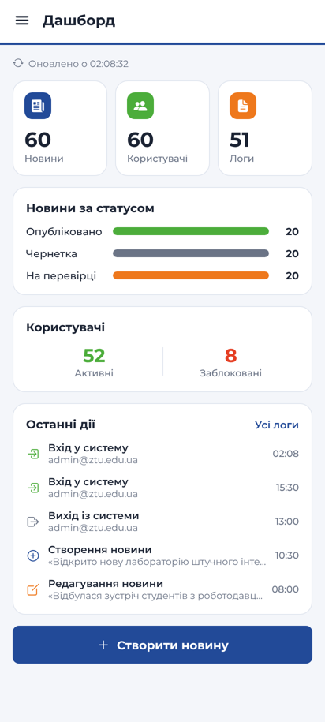 | 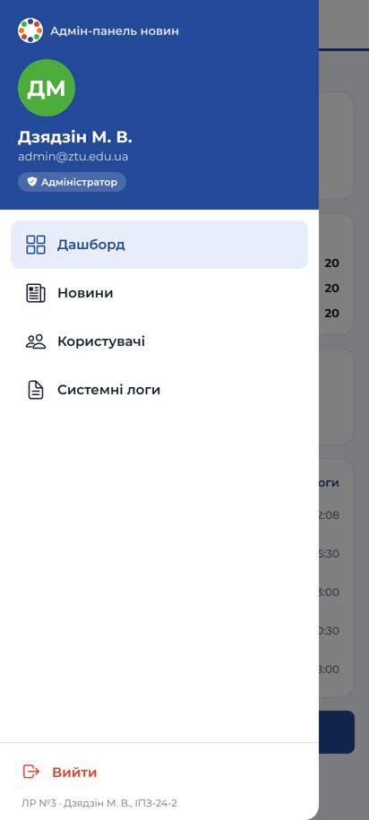 |

| Новини (VirtualizedList) | Фільтр новин (formSheet) | Результат фільтрації | Валідація форми (modal) |
|---|---|---|---|
|  |  | 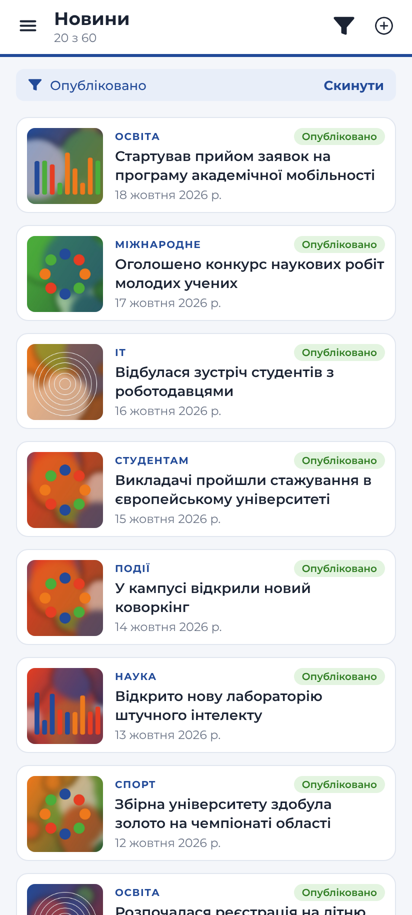 | 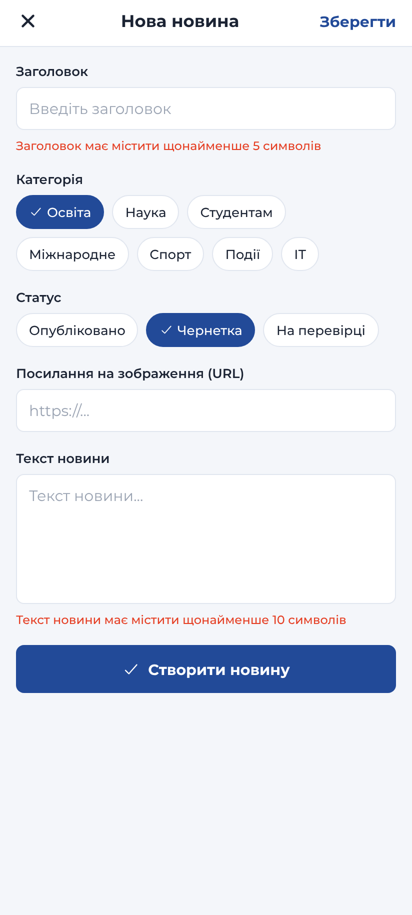 |

| Нова новина | Новину додано | Деталі `/news/[id]` | Редагування |
|---|---|---|---|
| 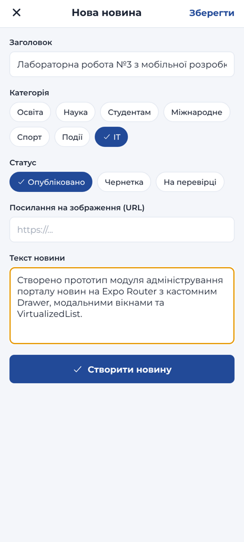 |  |  | 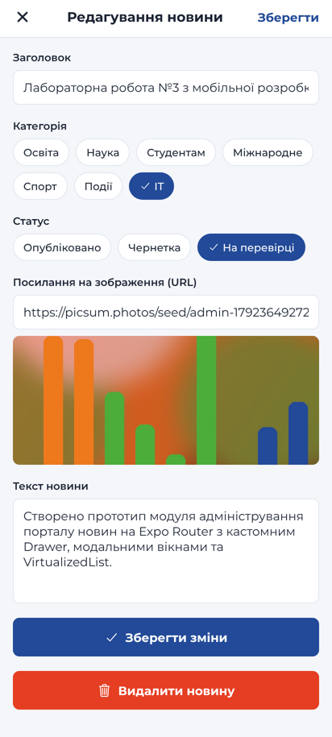 |

| Після редагування | Після видалення | Користувачі | Зміна статусу |
|---|---|---|---|
| 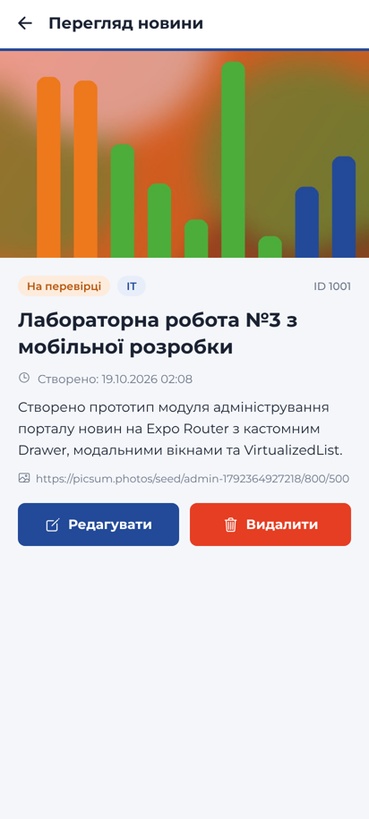 |  | 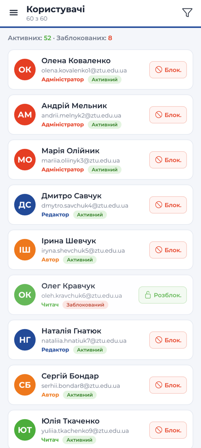 | 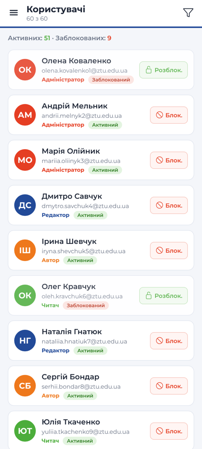 |

| Фільтр користувачів | Заблоковані | Системні логи | Дашборд після дій |
|---|---|---|---|
|  | 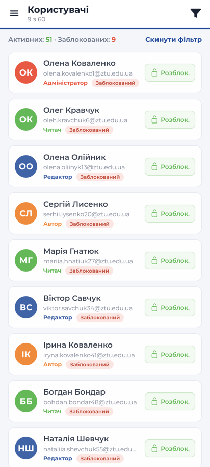 |  | 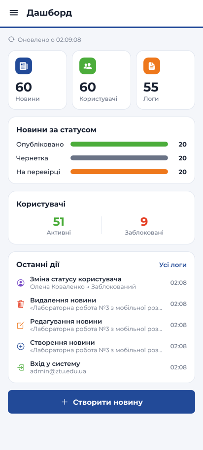 |

## Відповіді на контрольні запитання

**1. Яким чином виконується кастомізація бічного меню та хедера стекової навігації за допомогою `drawerContent` та `screenOptions.header`?**

Проп `drawerContent` навігатора `<Drawer>` приймає функцію, яка отримує `props` (`state`, `navigation`, `descriptors`) і повертає власний компонент замість стандартного списку пунктів. У `AdminDrawerContent` над пунктами є блок профілю, пункти виводить стандартний `DrawerItemList {...props}` усередині `DrawerContentScrollView` (тому працюють активний пункт, іконки й `drawerIcon` з опцій екранів), а кнопка «Вийти» закріплена внизу поза прокручуваною частиною. Опція `screenOptions.header` (або `header` конкретного екрана) повністю замінює стандартний хедер: функція отримує `{ navigation, route, options, back }` і повертає довільну розмітку. `AdminHeader` використовує `options.title`, `options.headerRight` і власне поле `headerSubtitle`, а за наявності `back` показує кнопку «Назад» замість кнопки меню (`navigation.dispatch(DrawerActions.toggleDrawer())`). Той самий компонент передано і в Drawer, і у вкладений Stack розділу новин, тому всі екрани мають однаковий хедер. Окремі екрани доповнюють його через `navigation.setOptions()` або `<Stack.Screen options={...} />`.

**2. У чому відмінність між нативними режимами модальних вікон `presentation: 'modal'` та `presentation: 'formSheet'`?**

`modal` — повноцінне модальне вікно для окремого завдання: на iOS це картка, що виїжджає знизу й майже повністю закриває попередній екран (закривається свайпом униз), на Android — новий екран поверх поточного. Підходить для форм, які вимагають повної уваги, як створення чи редагування новини. `formSheet` — нативна нижня панель (bottom sheet), висоту якої задає `sheetAllowedDetents`: масив часток висоти екрана (`[0.6, 0.95]`) або `'fitToContents'`. Користувач може перетягувати панель між цими положеннями за «ручку» (`sheetGrabberVisible`), а попередній екран частково лишається видимим. Додатково налаштовуються `sheetInitialDetentIndex`, `sheetCornerRadius`, `sheetExpandsWhenScrolledToEdge`. Цей режим зручний для допоміжних дій, що не відривають від контексту, наприклад фільтрів. В обох режимах вікно закривається через `router.back()` або жестом.

**3. Для чого використовується хук `useFocusEffect` і чим він відрізняється від стандартного `useEffect`?**

У навігаторах екрани зазвичай не демонтуються при переході: дашборд лишається змонтованим, поки користувач працює в інших розділах чи модальних вікнах. Тому `useEffect(..., [])` спрацює лише один раз при першому монтуванні, а при поверненні на екран не виконається. `useFocusEffect` запускає колбек **щоразу, коли екран отримує фокус** (повернення з іншого пункту меню, закриття `modal` / `formSheet`), а функцію очищення — при втраті фокуса. Колбек обгортають у `useCallback`, щоб ефект не перезапускався на кожному рендері. На дашборді в ньому перераховується статистика й оновлюється час «Оновлено о …». Типові сценарії — оновлення даних, підписки, таймери чи запити, які потрібні лише видимому екрану.

## Висновки

У роботі створено прототип адмін-панелі порталу новин на файловій маршрутизації Expo Router. Ієрархію навігації побудовано так: кореневий Stack із захищеними групами (`Stack.Protected`), Drawer для службових розділів і вкладений Stack для новин із динамічним маршрутом `/news/[id]`. Бічне меню та хедер кастомізовано через `drawerContent` і `screenOptions.header`. Для створення, редагування та фільтрації використано нативні режими `modal` і `formSheet` з `sheetAllowedDetents`, а видалення підтверджується нативним діалогом `Alert.alert()`. Списки новин, користувачів і логів реалізовано на `VirtualizedList` з `getItemCount`, `getItem` і `getItemLayout`. Фіксована висота рядків дає змогу не вимірювати елементи та миттєво обчислювати їхнє положення. Журнал фіксує лише шість визначених системних подій, а дашборд актуалізує дані через `useFocusEffect`.
